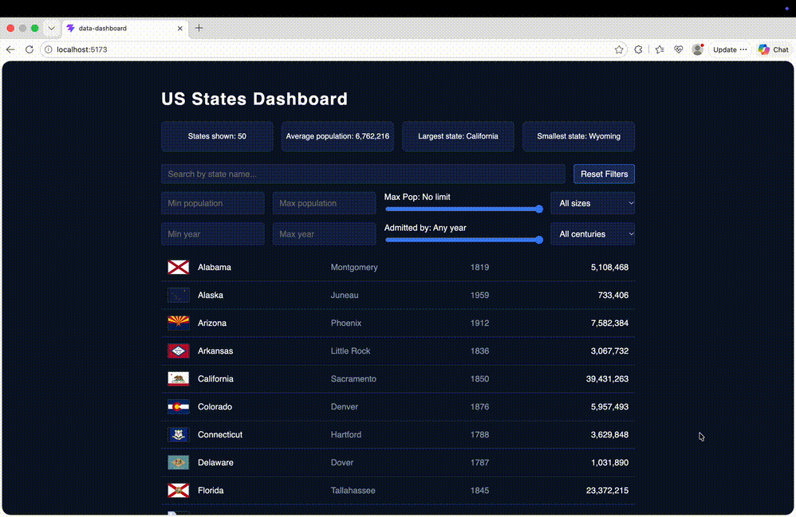

# Web Development Project 5 - US States Dashboard

Submitted by: **Edward Quan**

This web app: **is a data dashboard that shows all 50 US states with their flag, capital, year admitted to the union, and population. Users can search by name and filter by population size, population bounds, century admitted, and admission year, while four summary statistics update live to describe whatever states are currently shown.**

Time spent: **10** hours spent in total

## Required Features

The following **required** functionality is completed:

- [x] **The site has a dashboard displaying a list of data fetched using an API call**
  - The dashboard should display at least 10 unique items, one per row
    - All 50 states are displayed, one per row
  - The dashboard includes at least two features in each row
    - Each row shows the state's flag, name, capital, year admitted, and population
- [x] **`useEffect` React hook and `async`/`await` are used**
- [x] **The app dashboard includes at least three summary statistics about the data** 
  - The app dashboard includes at least three summary statistics about the data, such as:
    - Number of states currently shown (total count)
    - Average population of the states shown
    - Largest state by population
    - Smallest state by population
- [x] **A search bar allows the user to search for an item in the fetched data**
  - The search bar **correctly** filters items in the list, only displaying items matching the search query
  - The list of results dynamically updates as the user types into the search bar
- [x] **An additional filter allows the user to restrict displayed items by specified categories**
  - The filter restricts items in the list using a **different attribute** than the search bar 
    - The search bar uses the state name; the filters use population size and year admitted
  - The filter **correctly** filters items in the list, only displaying items matching the filter attribute in the dashboard
  - The dashboard list dynamically updates as the user adjusts the filter

The following **optional** features are implemented:

- [x] Multiple filters can be applied simultaneously
  - Search, population size, population min/max, century admitted, and admission year min/max all work together
- [x] Filters use different input types
  - e.g., as a text input, a dropdown or radio selection, and/or a slider
  - Text input (search), number inputs (min/max population and year), dropdowns (size and century), and range sliders (max population and admitted-by year)
- [x] The user can enter specific bounds for filter values
  - Min and max boxes for both population and admission year

The following **additional** features are implemented:

* [x] Reset Filters button that clears every search and filter at once
* [x] Population and year sliders stay in sync with their number boxes by sharing the same state; the far right of each slider means "no limit"
* [x] Specific messages when nothing matches, including when a minimum is greater than a maximum
* [x] Error handling for failed network requests and bad server responses
* [x] Accessible labels on all inputs, and visible keyboard focus styles
* [x] Responsive layout that adapts to narrow screens
* [x] Reusable `StateInfo` component for each row

## Video Walkthrough

Here's a walkthrough of implemented user stories:

GIF created with Kap

## Notes

Challenges encountered while building the app:

- **CORS error with the NHL API.** I first planned a dashboard with NHL standings, but the browser blocked the requests because the NHL server doesn't send the header that allows browser pages to read its data. Since this was for a class project, I switched to a US states API that doesn't have that problem and kept the same fetch code.
- **Population was stored as text with commas** (for example `"5,108,468"`), so I wrote a helper that removes every comma and converts it to a number. My first version only removed the first comma, which put some states in the wrong size group.
- **Using `reduce` safely.** The average needs a starting value of `0`, and the largest and smallest states needed a guard so the page doesn't crash when a search matches no states.
- **Admission dates were text** (for example `"December 14, 1819"`), and two entries had a trailing space, so I trimmed the text before pulling out the year.
- **Keeping inputs in sync.** Each slider shares its state with its number box, so dragging one updates the other and the reset button clears both.

## License

    Copyright 2026 Edward Quan

    Licensed under the Apache License, Version 2.0 (the "License");
    you may not use this file except in compliance with the License.
    You may obtain a copy of the License at

        http://www.apache.org/licenses/LICENSE-2.0

    Unless required by applicable law or agreed to in writing, software
    distributed under the License is distributed on an "AS IS" BASIS,
    WITHOUT WARRANTIES OR CONDITIONS OF ANY KIND, either express or implied.
    See the License for the specific language governing permissions and
    limitations under the License.